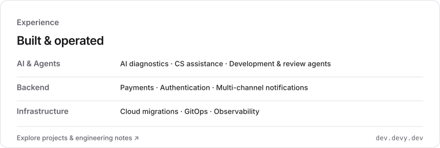

  <picture>
    <source media="(prefers-color-scheme: dark)" srcset="./assets/profile-hero-dark.svg" />
    <source media="(prefers-color-scheme: light)" srcset="./assets/profile-hero-light.svg" />
    
  </picture>

  <a href="https://dev.devy.dev/about/" title="기술 스택과 관련 경험 보기">
    <picture>
      <source media="(max-width: 600px) and (prefers-color-scheme: dark)" srcset="./assets/profile-tech-stack-mobile-dark.svg" />
      <source media="(max-width: 600px)" srcset="./assets/profile-tech-stack-mobile-light.svg" />
      <source media="(prefers-color-scheme: dark)" srcset="./assets/profile-tech-stack-dark.svg" />
      
    </picture>
  </a>

  <a href="https://dev.devy.dev/about/">
    <picture>
      <source media="(max-width: 600px) and (prefers-color-scheme: dark)" srcset="./assets/profile-experience-mobile-dark.svg" />
      <source media="(max-width: 600px)" srcset="./assets/profile-experience-mobile-light.svg" />
      <source media="(prefers-color-scheme: dark)" srcset="./assets/profile-experience-dark.svg" />
      
    </picture>
  </a>

## 스피카 (Spica)

Devy를 나타내는 개인 마스코트. 현재 기준은 **달과 별(G), 캐릭터 버전 2.0.0**이다.

  

스피카를 사용하는 사람과 AI 세션은 아래 자료부터 확인한다.

| 필요한 자료 | 위치 |
| --- | --- |
| 전체 안내·외형 유지 규칙 | [스피카 자료 안내](assets/devy/README.md) |
| 기준 이미지·벡터 | [투명 PNG](assets/devy/spica-character-g.png) · [웹용 SVG](assets/devy/spica-character.svg) |
| 이름·성격·표정·선택 장식 | [캐릭터 카드](assets/devy/devy-character-card.txt) |
| 이미지 제작 프롬프트 | [한국어·영어 재사용 프롬프트](assets/devy/spica-character-prompt.txt) · [원본 제작 기록](assets/devy/spica-g-image-prompt.txt) |
| 색상·파일 정보 | [캐릭터 메타데이터](assets/devy/spica-character.json) |
| 펫 제작·설치·애니메이션 | [Codex Pet v2 안내](assets/devy/pet-v2/README.md) · [설치 ZIP](assets/devy/pet-v2/spica-improved-v2.zip) |

### 이미지 만들기

1. **기준 PNG를 실제로 열고 참조 이미지로 첨부**한다. 캐릭터 카드와 재사용 프롬프트를 함께 읽는다.
2. 재사용 프롬프트의 `이번 그림에서 변경할 내용`에 표정·포즈·상황·배경을 적는다.
3. 완성된 그림에서 매끈하게 닫힌 금빛 원형 고리, 남색 얼굴, 작은 발 두 개와 **오른쪽 눈 위의 독립 초승달·네 갈래 별 하나**가 유지됐는지 확인한다. 달은 오른쪽으로 열리고 고리·눈과 떨어져 있어야 한다. 말린 돌기나 손·팔을 추가하지 않는다.

기존 모습이 그대로 필요하면 저장된 PNG나 SVG를 재사용한다. 새로 생성한 그림은 기준 이미지와 비교해 외형을 검수한다.
세 점 별자리, 보랏빛 볼터치와 처녀자리 기호 ♍는 선택 장식이다.

### 펫 만들기

기존 펫을 사용할 때는 **설치 ZIP**을 받는다. 같은 스피카로 새 펫이나 동작을 만들 때는 다음 순서로 진행한다.
`legacy/`는 이전 디자인의 보존 자료이므로 현재 G 기본형의 기준으로 사용하지 않는다.

1. [펫 안내](assets/devy/pet-v2/README.md), [제작 요청·외형 조건](assets/devy/pet-v2/source/generation-request.json), [시선 표현 기준](assets/devy/pet-v2/source/look-mechanics.md)을 읽고 기준 PNG를 참조 이미지로 사용한다.
2. [작업별 프롬프트 기록](assets/devy/pet-v2/source/recovered-generation-prompts.json)과 [생성 원본](assets/devy/pet-v2/source/generated/)을 참고해 필요한 동작을 제작한다. 이 프롬프트는 생성 기록에서 복구한 원문이며, 당시의 첨부 이미지 목록과 호출 설정 전체를 담고 있지는 않다.
3. 기존 v2 자료의 **9가지 동작·16방향 시선, 8열 × 11행, 셀 192 × 208, 사용 프레임 73개** 규격과 [프레임 배치 정보](assets/devy/pet-v2/animations.json)를 따른다. 기존 동작을 재사용하려면 [분리된 PNG 프레임](assets/devy/pet-v2/frames/)을 사용한다. 비대칭인 달·별 표식이 뒤집히므로 좌우 동작을 단순 반전하지 않는다.
4. [동작 미리보기](assets/devy/pet-v2/previews/)와 비교해 크기·기준선·시선 방향·표식 위치를 확인하고, 새 시트와 애니메이션을 검증한 뒤 패키징한다. [기존 검수 기록](assets/devy/pet-v2/qa/)은 참고 자료이며 새 파일의 검증을 대신하지 않는다.

### 다른 세션에 요청하기

아래 문구를 복사하고 대괄호 부분을 바꿔서 사용한다.

> `devy1540/devy1540`의 루트 README와 `assets/devy/README.md`를 읽어줘. `assets/devy/spica-character-g.png`를 실제로 열고 참조 이미지로 사용해서, 캐릭터 카드·재사용 프롬프트에 따라 스피카의 [표정·포즈·상황] 이미지를 만들어줘. G 기본형의 원형 고리와 오른쪽 눈 위의 초승달·네 갈래 별을 유지해줘. 펫 제작 요청이면 `assets/devy/pet-v2/README.md`와 제작 요청·시선 기준·프레임 배치 정보도 읽고 [원하는 동작]을 제작·검수해줘.
